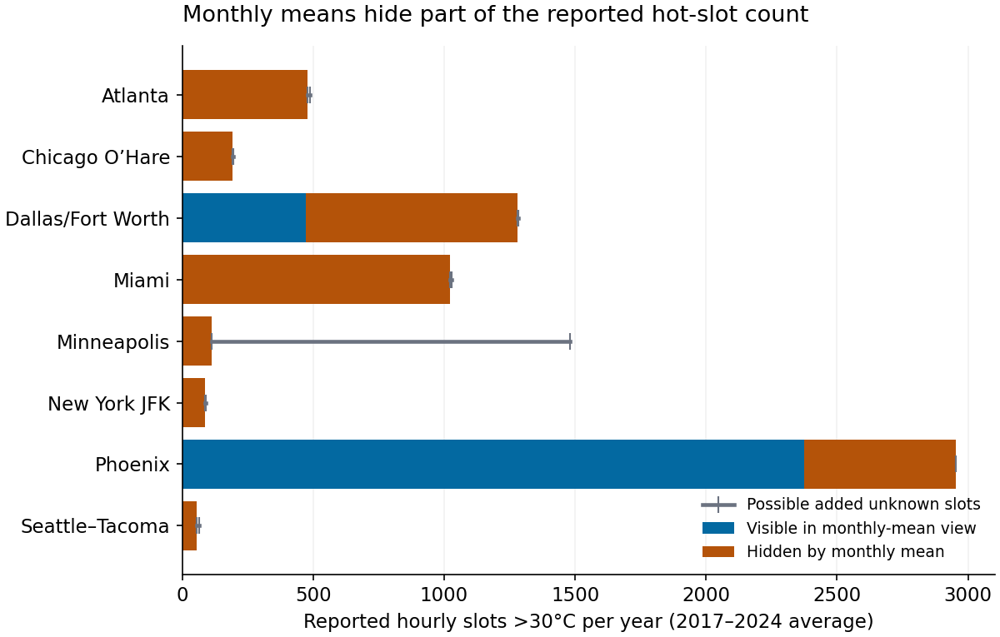

# Monthly means and reported temperature extremes

Monthly outdoor-temperature averages can hide frequent threshold crossings in the underlying readings. This study makes that aggregation choice and its missing-data limits inspectable before anyone uses a weather summary in a storage contingency scenario.

At eight fixed US airport stations in **2017–2024**, replacing each reported near-hour temperature with its own observed monthly mean hides **26,642 of 49,423** reported slots above the illustrative **30°C** threshold (**53.9%**). The monthly view also labels **8,059** non-exceeding observed slots positive. Six airport cases have every reported positive hidden by their observed monthly means. This is a retrospective aggregation comparison, without a claim that an actual dashboard or alert system behaved this way.

**Practical implication:** show threshold counts, observed coverage and unknown-slot bounds alongside the mean. Minneapolis has **15.6% unknown held slots**; its mean annual positive-count bound is **110.750–1,481.500**, overlapping Dallas/Fort Worth's **1,279.500–1,282.250**. The recorded subset cannot establish that full-grid ordering. Facility measurements and a quality-bearing source are needed before an operational contingency choice.

Read the [eight-page manuscript](paper/manuscript.pdf), [fixed protocol](PROTOCOL.md), [primary sources](SOURCES.md), [additional merge-notice limit](SOURCE_NOTICE.md) and [reuse boundary](DATA_RIGHTS.md). These are near-hour outdoor samples, not continuous exposure duration, warehouse/product temperatures, spoilage, realized savings or future-climate coverage. ISD-Lite omits full quality flags; individual observation QC remains unverified. This is AI-assisted independent research, without peer-review or a novel-estimator claim.



The full 2010–2024 source has 120 station/year objects and 1,051,655 rows, reconciled to the complete UTC calendar. All 11,342 unknown temperature slots remain explicit. Development is 2010–2016; eighteen canonical dependencies were frozen publicly before held analytical summaries. Inputs and source-quality counts were visible, not blinded. All three fixed illustrative thresholds, 4,320 monthly rows, 360 annual rows, 48 phase rows and all 24,000 whole-year replicate rows remain in [results](results/). The thresholds are untuned outdoor scenarios, without product-safety or manufacturer approval.

The nominal 90% whole-year resampling ranges condition on the recorded years and their missingness. Shared year indices preserve within-year and contemporaneous cross-airport structure. Trends, multi-year dependence, sparse years and source quality limit interpretation; these intervals do not fill missing temperatures or establish future coverage. Empirical tails/runs describe the reported source product, without fitted extreme-value return levels or proven continuous physical duration.

## Reproduce

Python 3.10 with pinned NumPy 2.2.5, Matplotlib 3.10.9 and pypdf 6.10.0. After dependency installation, replay requires no network or private originals.

```text
python -m pip install -r requirements.txt
python -m unittest discover -s tests -v
python src/check_reproduction.py
python src/verify_figures.py
python src/verify_paper.py
python src/verify_public_package.py
```

Twelve fixtures pass. Independent whitespace/source-locator parsing checks 5,258,275 selected fields and 8,413,240 projected scalars. Independent calendars, SQLite grouped sums, window-island runs and order statistics verify 190,540 exact scalars and 66,840 reported floats, including every retained bootstrap replicate. Isolated replay matches 330,561 fields/documents. All 200 plotted values and 96 heatmap text/contrast pairs are checked; the heatmap uses the natural 0–100% range. These finite checks do not establish universal correctness, full observation QC or accessibility conformance.

Only selected public station/time/temperature facts, hashes and original analysis are published. Full source files, agency documents and artwork stay outside Git. NOAA's published cloud archive is used with attribution; the analysis is a derivative without NOAA endorsement. ISD ceased updates after August 2025, so this is not current weather or the latest GHCNh product. Reviewed independent manuscripts are authorized; separate formal-publication projects such as Azure optimization remain private. Exact CI/tree/tag publication state is recorded in release receipts.
